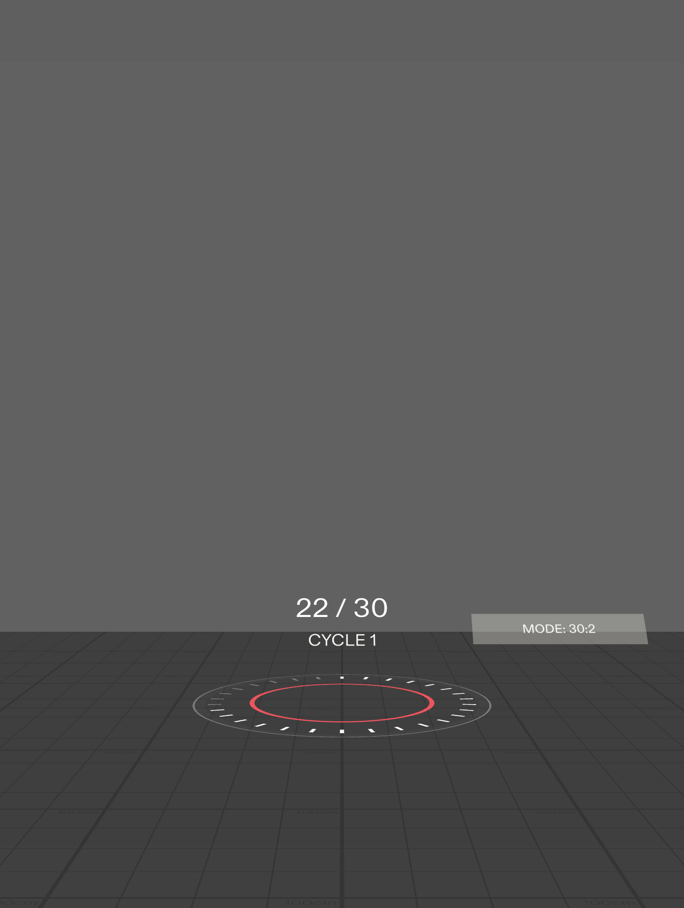
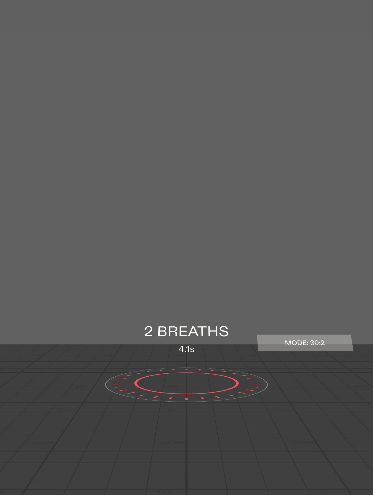
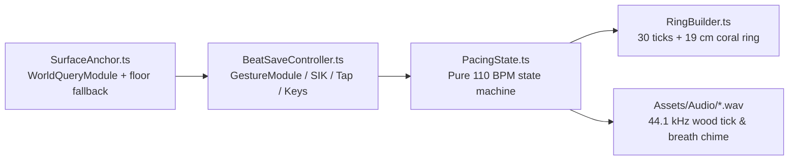

# BeatSave

**Look down. Pinch once. Keep the beat.** — Hands-free 110 BPM CPR pacer for Snap Spectacles.


[](https://youtu.be/SLdakCRsrS8)

Watch the 46-second demo in Lens Studio 5.23.2 (`SPECS 27`, `Sunlit Room`): [https://youtu.be/SLdakCRsrS8](https://youtu.be/SLdakCRsrS8)

---

## Why It Exists

During CPR, a rescuer has no free hand to unlock a phone, prop up a screen, or count to 30 under stress.
BeatSave anchors a 26 cm visual and acoustic pacing ring onto the floor around the rescuer's hands on Snap Spectacles.
A 16 cm open center keeps stacked hands unobstructed while the 35-degree readout stays visible above the rim.

---

## Live State Walkthrough

| `PLACING` | `30:2 PACING` | `2 BREATHS` | `HANDS-ONLY` |
| :---: | :---: | :---: | :---: |
|  |  |  |  |
| Ring glides over the floor under gaze until locked with one pinch. | 30 radial ticks advance at 110 BPM (`60/110 s`) with coral + pitch accents on beats 28–30. | 5.0 s breath countdown plays a harmonic chime before starting the next cycle. | Spatial pill toggles continuous 110 BPM pacing with a 30-beat lap counter. |

---

## Architecture & Zero-Allocation Design



- **Zero per-frame allocations:** `RingBuilder.ts` pre-builds the 26 cm outer track, perimeter hairline, 30 radial ticks, and 19 cm inner pulse ring on startup, updating tick materials only on state transitions via dirty-state guards.
- **Exact 110 BPM timing:** `PacingState.ts` isolates timing math from engine globals and is verified across 150 beats (5 full cycles) in both `30:2` and `HANDS-ONLY` modes with zero cumulative drift.
- **Additive optics palette:** Strictly uses Matte Obsidian (`#141413`), Warm Off-White (`#F4F3EE`), Signal Coral (`#E63946`), and Muted Slate (`#6E6D68`).

---

## Quickstart & Verification

### Run in Lens Studio 5.23.2
1. Open `BeatSave-Lens.esproj` in **Lens Studio 5.23.2** (do not upgrade to 5.25+ packages).
2. In the **Preview** panel, set **Simulation Mode** to **SPECS 27**, select **Sunlit Room** (or **Plane**), set input to **Interactive**, and unmute Preview audio.
3. Controls:
   - **Pinch** or `Space`: Lock ring and start Beat 1 (`COMPRESSIONS`); short tap pauses/resumes (`PAUSED`).
   - **Mode Pill** or `M`: Toggle `30:2` and `HANDS-ONLY`.
   - **Hold Pinch (1.2 s)** or `R`: Unlock and return to `PLACING`.

### Run Automated Checks
```bash
tsx --test tests/*.test.ts
python tools/generate_audio.py
python tools/check_buzzwords.py
```

---

## Honest Scope & Boundaries

BeatSave is a **rhythm and counting aid only**—not a medical diagnostic device. It does **not** measure chest compression depth, chest recoil, pulse, heart rate, or breathing. All timing logic and runtime transitions are verified in Lens Studio 5.23.2 Preview simulator (`SPECS 27`) and automated Node tests; comfort, ergonomics, and hand-tracking stability during multi-minute manikin sessions remain to be evaluated on physical Snap Spectacles hardware.

---

## Repository Layout

```text
BeatSave-Lens/
├── BeatSave-Lens.esproj      # Lens Studio 5.23.2 Spectacles manifest (SIK 0.18.0)
├── Assets/
│   ├── Scene.scene           # Wired camera, DeviceTracking, BeatSaveUnlit.mat, ModeTogglePill
│   ├── Scripts/              # PacingState.ts, RingBuilder.ts, SurfaceAnchor.ts, BeatSaveController.ts
│   ├── Materials/            # BeatSaveUnlit.mat & unlit.graphShader
│   └── Audio/                # wood_tick.wav, wood_tick_accent.wav, breath_chime.wav
├── devpost/
│   ├── design-brief.md       # Spatial design brief
│   └── media/                # Preview screenshots, thumbnail_1200x675.png, beatsave_demo.mp4
├── docs/                     # DEVPOST_DRAFT.md & synced DEMO_SCRIPT.md
├── tests/                    # Automated 110 BPM multi-cycle Node unit tests
├── tools/                    # Audio generator, buzzword scanner, and desktop recorder
└── LICENSE                   # MIT License
```
