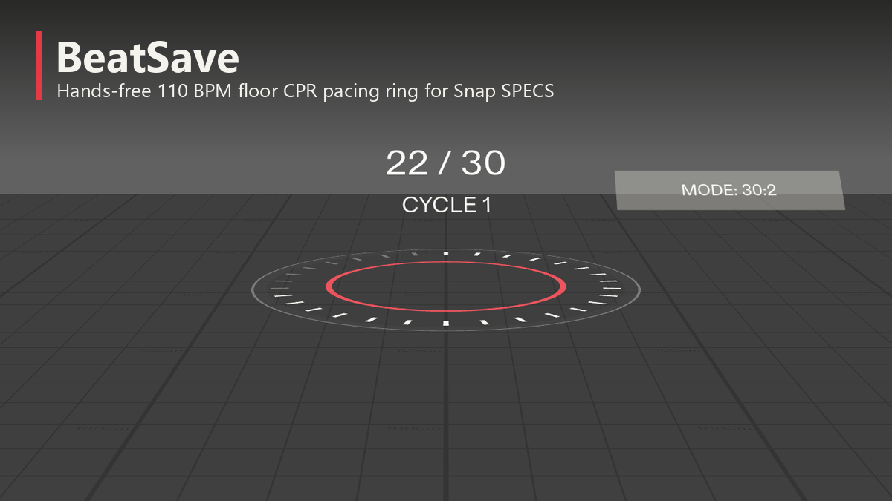
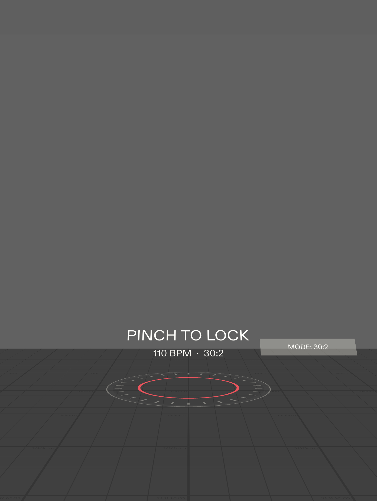
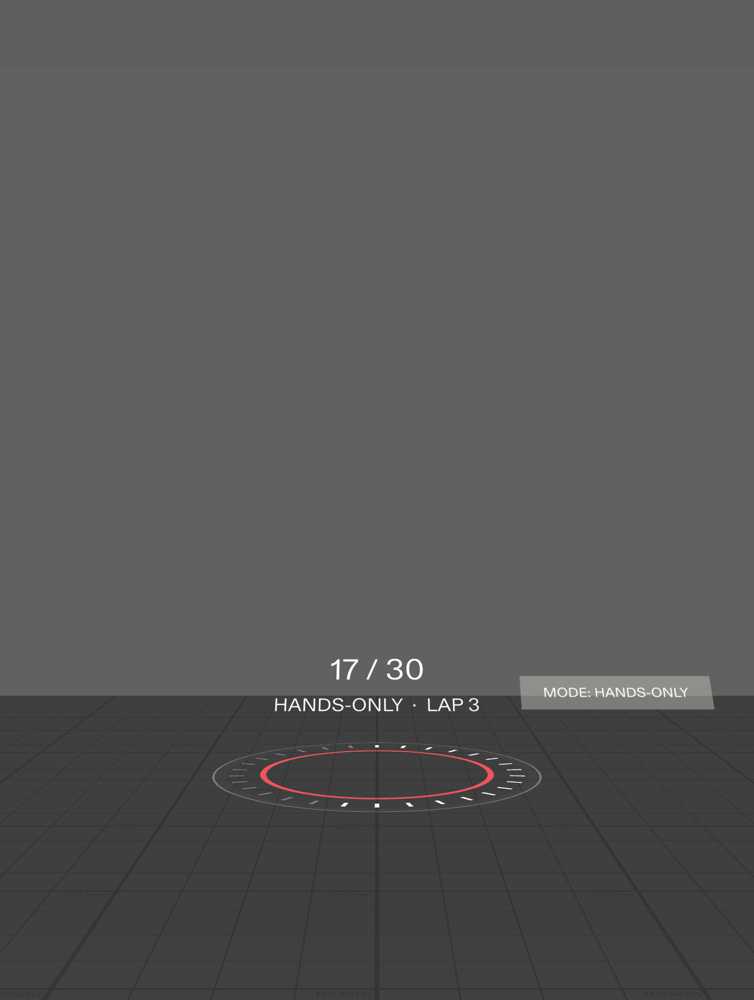

# BeatSave

**Lock a 110 BPM CPR pacing ring onto the floor. Keep both hands free when every second counts.**

Built natively in TypeScript for **Snap SPECS / Lens Studio 5.23.2** (`Specs Base Template With Examples`, `SpectaclesInteractionKit` 0.18.0).

> **Disclaimer:** BeatSave is a hands-free rhythm and counting aid only. It is not a medical diagnostic device and does not measure compression depth, chest recoil, pulse, heart rate, or breathing.

## What BeatSave Does
BeatSave anchors a 26 cm (0.26 m) visual and acoustic CPR pacing ring onto a flat surface (floor, cushion, or training manikin) with a single pinch:

- **110 BPM Rhythm:** Exact `60 / 110 s` (`0.5455 s`) interval centered within the AHA 100-120 BPM guideline.
- **Hand-Clear Geometry:** Leaves an unobstructed ~16 cm inner zone for stacked hands while 30 radial ticks illuminate around the outer perimeter and a 19 cm Signal Coral ring pulses smoothly outside the hand area.
- **35° World-Locked Readout:** Sits 17.5 cm beyond the top edge of the ring, angled 35° toward the kneeling rescuer so arms never hide the count (`01 / 30`, `CYCLE 1`, or `2 BREATHS` + `5.0s` countdown).
- **Two AHA Modes:**
  - `30:2` (Default): 30 compressions (with raised wooden pitch and Signal Coral accents on beats 28, 29, and 30) followed by a `5.0 s` breath window, then automatically advances to Cycle 2, 3, and beyond.
  - `HANDS-ONLY`: Continuous 110 BPM pacing with a 30-beat visual lap counter, toggled via the spatial pill beside the readout.
- **Natural Acoustic Cues:** Three offline 44.1 kHz 16-bit mono PCM `.wav` clips (`wood_tick.wav`, `wood_tick_accent.wav`, `breath_chime.wav`) synthesized with zero harsh square-wave beeps.

## Live Lens Studio 5.23.2 Captures

Demo recording: [beatsave_demo.mp4](devpost/media/beatsave_demo.mp4) (1920x1080 H.264 + 44.1 kHz AAC, assembled from sequential Lens Studio Preview captures synced to log timestamps and `Assets/Audio/*.wav` cues).

| Surface Placement (`PLACING`) | Active Pacing (`30:2`) | Breath Window (`2 BREATHS`) | Hands-Only Mode |
| --- | --- | --- | --- |
|  |  |  |  |

## Setup & Run in Lens Studio 5.23.2
1. Open `BeatSave-Lens.esproj` in **Lens Studio 5.23.2** (do not upgrade to 5.25+ or install 5.25+ preview packages).
2. In the **Preview** panel, set **Device Type Override** to **SPECS** (or **Simulation Mode** to **SPECS 27**), set Input to **Interactive**, and unmute Preview audio.
3. Controls in Interactive Preview:
   - `Space` or click/pinch: Lock the ring to the surface and start Beat 1 (`COMPRESSIONS`); subsequent short taps pause/resume (`PAUSED`).
   - `M` (or pinch `MODE: 30:2` pill): Toggle between `30:2` and `HANDS-ONLY`.
   - `R` (or hold pinch `1.2 s` on Spectacles): Unlock and return to `PLACING` to reposition.

## Color Palette
- Matte Obsidian: `#141413`
- Warm Off-White: `#F4F3EE`
- Signal Coral: `#E63946`
- Muted Slate: `#6E6D68`

## Project Structure
- `BeatSave-Lens.esproj` — Lens Studio 5.23.2 Spectacles project manifest (`SpectaclesInteractionKit` 0.18.0)
- `Assets/Scene.scene` — Native Lens Studio scene wiring `Camera Object`, `Device Tracking`, `BeatSaveUnlit.mat`, `ModeTogglePill`, and `BeatSaveController`
- `Assets/Scripts/PacingState.ts` — Pure TypeScript 110 BPM state machine (unit-tested)
- `Assets/Scripts/RingBuilder.ts` — Procedural 26 cm dial, 30 radial ticks, and 19 cm spring pulse ring via `MeshBuilder`
- `Assets/Scripts/SurfaceAnchor.ts` — `WorldQueryModule` surface hit-test + preview floor-plane fallback
- `Assets/Scripts/BeatSaveController.ts` — Main `BaseScriptComponent` controller (`GestureModule`, `Interactable`, `TapEvent`, `KeyPressEvent`)
- `Assets/Audio/` — `wood_tick.wav`, `wood_tick_accent.wav`, `breath_chime.wav`
- `tools/generate_audio.py` — Standard-library WAV synthesizer and header/clipping verifier
- `tools/check_buzzwords.py` — Documentation and brief buzzword scanner
- `tests/pacing-state.test.ts` — Automated timing, cycle, mode, pause/resume, and hold-reset tests
- `devpost/design-brief.md` — `plan-lens` spatial design brief
- `devpost/media/` — Captured Preview screenshots, 1200x675 thumbnail, and `beatsave_demo.mp4`
- `docs/DEVPOST_DRAFT.md` — Submission write-up
- `docs/DEMO_SCRIPT.md` — Timestamped voiceover script synced to `beatsave_demo.mp4`

## Verification Commands & Status
- **TypeScript & Lens Studio Compilation:** `RecompileTypeScriptTool` (`succeeded`) and `tsc -p Cache/TypeScript/Src/tsconfig.json --noEmit` (0 errors in `Assets/Scripts/*`).
- **State Machine Unit Tests:** `tsx --test tests/*.test.ts` (6/6 passing across 150-beat multi-cycle drift, 30:2 breath transition, HANDS-ONLY mode, pause/resume, and `1.2 s` hold-to-reset).
- **Audio & Docs Checks:** `python tools/generate_audio.py` (all 3 `.wav` files 44.1 kHz 16-bit mono, peak <= 0.90) and `python tools/check_buzzwords.py` (0 hits).
- **Runtime Interaction Check:** Driven in Lens Studio 5.23.2 Preview (`SPECS 27` override, `errors: []`) confirming `PLACING -> COMPRESSIONS -> BREATH_PAUSE -> COMPRESSIONS (Cycle 2) -> HANDS_ONLY -> PLACING`.
- **Lens Studio 5.23.2 LEAF Note:** Asset Library `Leaf` 4.0.0 targets Lens Studio 5.25+, `Leaf` 3.0.0 returns HTTP 404 on install, and `[ChatTool] LEAF Plugin` 5.23.0 faults with `InternalError: Panel can not be null`. Runtime verification in 5.23.2 therefore relies on `RunAndCollectLogsTool`, live Preview captures, and the Node unit suite.
